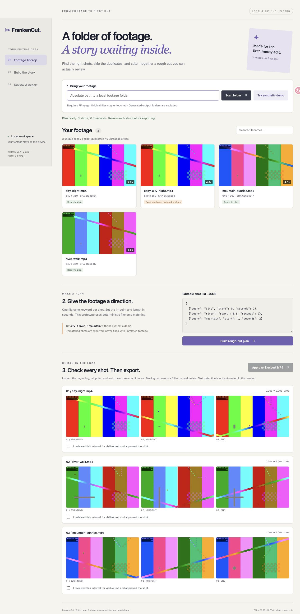

# FrankenCut

**A folder of footage. A story waiting inside.**

FrankenCut is a local-first video asset manager and human-reviewed rough-cut
builder. It combines a searchable footage library, content hashing, interval
preview frames, and FFmpeg editing in one small tool. It is being developed as a
new project for the **Frankenstein** category of Kiroween 2026.



## Run

Requirements: **Python 3.9+**, **FFmpeg** and **ffprobe** on your PATH. There are
no Python packages to install and no cloud account or API key is needed to run
this prototype. Install FFmpeg from [the official FFmpeg site](https://ffmpeg.org/download.html)
or a trusted package manager.

```sh
python3 frankencut.py serve
```

Open **http://127.0.0.1:8765** in your browser. Click **Try synthetic demo**, then
**Build rough-cut plan**. Review the beginning, midpoint, and end of each shot,
check the approval box for every shot, and click **Approve & export MP4**.

The demo generates original color-pattern footage: three unique four-second
clips and one byte-for-byte duplicate. Filenames are illustrative; these are
**synthetic test clips, not actual travel footage**. The default plan produces a
six-second silent vertical rough cut.

To use your own footage, enter a local absolute folder path and click **Scan
folder**. Change the JSON shot list to match words in your filenames.

## What works today

- Recursive MP4 / MOV / MKV / WEBM / M4V indexing, metadata and SHA-256 hashes.
- Filename keyword search and byte-identical duplicate flags.
- Deterministic shot matching; unmatched requests cause an explicit error.
- Preview frames at the beginning, midpoint, and end of the **selected interval**.
- A required manual per-shot text-review gate and explicit export approval.
- Source hash revalidation and nested JSON ban-list checks before rendering.
- 720 × 1280 H.264 MP4 export through FFmpeg; letterboxing preserves the source
  frame instead of silently cropping it. Original audio is omitted.
- A loopback-only dashboard with same-origin write checks and file serving
  restricted to application files, generated thumbnails, and generated exports.

## A small, honest prototype

Search currently uses **filename keywords**, not semantic embeddings. Duplicate
detection is exact hashing, not perceptual similarity. Visible-text detection is
**manual**, not automatic OCR. There are no burned-in captions, transitions,
music, scene detection, or AI-generated footage in this version.

Three preview frames are a minimum inspection aid, not proof that a clip is
text-free. Moving signs, stickers, or scrolling text require a fuller review of
the original clip. Future work includes scene boundaries, local OCR, semantic
search, and richer timeline editing. These features are not claimed as complete.

The JSON shot list uses `query`, `start`, and `seconds`. Editing the shot list
invalidates the plan. Export rechecks the source hash and rejects intervals that
were changed without rebuilding the preview plan.

## Files and privacy

Original footage is read only. Generated data defaults to `workspace/` beside the
script. Nothing is uploaded to an AI service or cloud storage by this app.
`workspace/` and generated demo footage are excluded from Git.

```sh
python3 frankencut.py --workspace /path/to/generated-data serve
```

The scanner excludes generated folders such as `output`, `outputs`, `renders`,
`workspace`, and `样片输出`. Symlinks are not ingested. For footage under a folder
named `TK原素材`, the workspace must be inside that folder's `样片输出/` directory;
the app refuses an incompatible workspace before indexing.

Optional bans can be placed in `workspace/bans.json`. The renderer also checks
any `素材禁用清单.json` found in source ancestor directories. Supported nested
JSON structures contain SHA-256 strings and/or absolute source paths, for example:

```json
{"entries": [{"source_sha": "<64-character SHA-256>"}, {"path": "/absolute/source.mp4"}]}
```

Local paths remain in the generated library and export sidecar. Do not upload
those files if they contain private paths or footage metadata. The web server
listens on `127.0.0.1`, not on a public network interface.

## CLI workflow

```sh
python3 frankencut.py demo
python3 frankencut.py plan examples/shots.json
# Inspect the interval thumbnails listed in workspace/plan.json.
# Set each reviewed shot's text_review field to "pass".
python3 frankencut.py render --approve
```

Each export has a unique filename and an adjacent JSON shot-plan sidecar.

## Tests

```sh
python3 -m unittest discover -s tests -v
```

Tests cover unmatched requests, duplicate exclusion, review/approval gating,
changed files, stale intervals, nonfinite numbers, source boundaries, ban lists,
and generated-folder exclusion. A separate end-to-end check uses the synthetic
demo and a real FFmpeg export. See `docs/VALIDATION.md` for recorded results.

## Kiro and development provenance

The repository contains `.kiro/steering/` and `.kiro/specs/` with product
constraints and the development checklist. Codex built the initial prototype;
Kiro CLI reviewed the real Python pipeline, JavaScript UI, tests, and requirements
on 2026-11-17. Its review led to a single-snapshot plan-validation change and a
regression test. Findings were checked before applying them, including suggestions
that did not hold up against the code. See `docs/KIRO_USAGE.md` for the actual
task and contribution record. This is a working prototype; credit approval is
not guaranteed by a repository or a competition submission.

## Downloadable test build

Download the source archive from the repository's **Releases** page, extract it,
and follow [TESTING.md](TESTING.md). The test build runs locally and requires
Python 3.9+, FFmpeg and ffprobe. It does not require credentials or API keys.

## License

MIT. Demo media is generated locally from FFmpeg's synthetic source filter.

